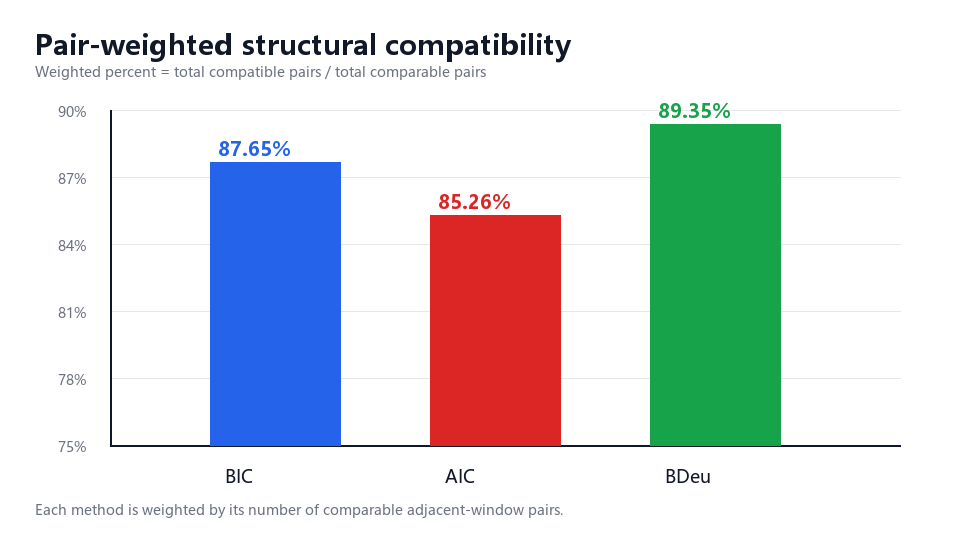

[English](README.md) | [简体中文](README.zh-CN.md)

# DNA Methylation Bayesian Structure Learning

This ongoing research asks whether the local dependence structure inferred from three adjacent CpG sites remains stable when the genomic window moves forward by one site. The question matters because a local model is useful only if its structure is not entirely determined by one arbitrary window boundary. Under the supervision of Prof. Pearson Antony, I built the analysis pipeline combining exhaustive three-node DAG scoring, adjacent-window compatibility analysis, and methylation-state transition modeling.

## Results at a glance

| Analysis quantity | Result |
|---|---:|
| ENCODE datasets | 121 |
| Input CpG triplets | 650,152 |
| Triplets retained after variability checks | 634,824 (97.64%) |
| Three-node DAGs scored per triplet | 25 |
| Triplet-structure score combinations | approximately 15.87 million |
| Comparable adjacent-window pairs | 461,271 |
| Pair-weighted agreement, BDeu | 89.35% |
| Pair-weighted agreement, BIC / AIC | 87.65% / 85.26% |
| Equal-weight dataset mean, BDeu | 87.60% |



Pair weighting answers how often two comparable windows agree across all observed pairs; the equal-weight dataset mean gives every dataset the same influence. Both are reported because dataset sizes vary substantially. Under either weighting scheme, BDeu produced the most consistent adjacent-window structures.

## What I implemented

- Vectorized ingestion and quality control for ENCODE methylation triplet files.
- Exhaustive scoring of all 25 three-node DAGs with BIC, AIC, and BDeu.
- Alignment of overlapping triplets and comparison of the shared two-node structure.
- Dataset-level and pair-weighted summaries with diagnostics for skipped observations.
- Empirical transition matrices for eight methylation states and a category-level Markov representation.
- Reproducible result tables and publication-ready figures.

The fitted local state process produced P(1 to 1) = 0.8369, P(0 to 0) = 0.3858, and stationary methylated-state probability pi1 = 0.7902. These values describe persistence within this fitted local model; they are not genome-wide causal estimates.

## What the results mean

The agreement analysis supports a narrow but useful conclusion: adjacent windows that share CpG sites usually preserve a compatible local dependence pattern, and BDeu is the most stable of the three scoring criteria in this dataset collection. The separate eight-state symbolic model shows why that empirical stability should not be over-interpreted. Exchangeability of methylation positions does not imply that CpG sites are independent, and without additional parameter restrictions the stationary joint distribution generally has no conditional independences. A faithful three-node Bayesian network is therefore usually complete; category-level methylation dynamics alone cannot identify a unique sparse graph or a causal direction.

## Repository guide

```text
scripts/       analysis, diagnostics, transition modeling, and visualization
figures/       selected aggregate figures
results/       compact tables used in this README
docs/          method definitions and analysis notes
data/          input schema and data-access instructions
```

## Reproduce the analysis

```bash
python -m pip install -r requirements.txt
python scripts/analyze_all_datasets.py --help
```

The full run expects locally downloaded ENCODE files in the schema described in [`data/README.md`](data/README.md). Bulk source files are not redistributed here.

## My role

Main researcher. I designed and implemented the processing, DAG-scoring, adjacent-structure comparison, transition analysis, diagnostics, and visualization workflow under faculty supervision.

## Project status

The repository contains the reviewed analysis code and compact aggregate results for the current research stage. Large ENCODE inputs and unpublished collaborator materials remain outside the public repository.

