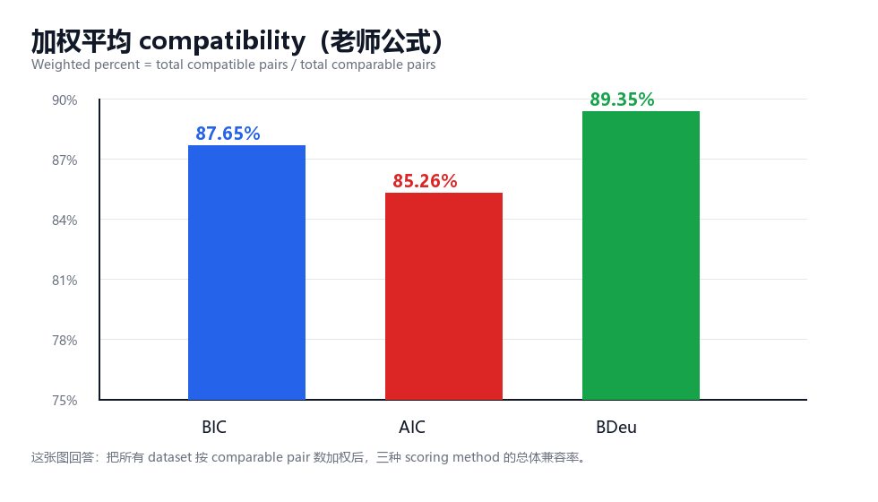

[English](README.md) | [简体中文](README.zh-CN.md)

# DNA 甲基化贝叶斯结构学习

本研究考察相邻 CpG 三元组的局部贝叶斯网络结构，在基因组窗口向后移动一个 CpG 位点时是否保持一致。我在 Pearson Antony 教授指导下设计并实现了分析流程，包括三节点 DAG 穷举评分、相邻窗口结构比较和甲基化状态转移建模。

## 主要结果

| 指标 | 结果 |
|---|---:|
| ENCODE 数据集 | 121 |
| 输入 CpG 三元组 | 650,152 |
| 通过变异性检查的三元组 | 634,824（97.64%） |
| 每个三元组比较的 DAG | 25 |
| 结构评分组合 | 约 1,587 万 |
| 可比较的相邻窗口对 | 461,271 |
| BDeu 成对加权一致率 | 89.35% |
| BIC / AIC 成对加权一致率 | 87.65% / 85.26% |
| BDeu 数据集等权平均 | 87.60% |



成对加权结果回答“所有可比较窗口中有多少保持一致”；数据集等权平均则让每个数据集具有相同权重。由于各数据集规模差异较大，两种统计量需要分别报告。

## 本人完成的工作

- 为 121 个 ENCODE 甲基化数据集构建向量化读取与质量控制流程。
- 使用 BIC、AIC 和 BDeu 穷举比较 25 个三节点 DAG。
- 对齐相邻重叠三元组并比较共享双节点结构。
- 汇总数据集级和成对加权结果，并诊断无法比较的观测。
- 建立八状态经验转移矩阵和类别层面的 Markov 表示。
- 生成可复核的汇总表与结果图。

拟合状态过程得到 P(1 到 1)=0.8369、P(0 到 0)=0.3858，平稳甲基化概率 pi1=0.7902。这些结果描述局部模型中的状态持续性，不代表全基因组因果效应。

## 目录与运行

```text
scripts/       分析、诊断、转移建模和可视化
figures/       主要结果图
results/       README 使用的汇总表
docs/          方法与指标说明
data/          输入格式和数据获取说明
```

```bash
python -m pip install -r requirements.txt
python scripts/analyze_all_datasets.py --help
```

完整运行需要按 [`data/README.md`](data/README.md) 下载并整理 ENCODE 输入文件。仓库不重复分发大体量源数据。

## 个人职责

主要研究者。在导师指导下，我负责数据处理、DAG 评分、相邻结构比较、转移分析、诊断和可视化流程。

